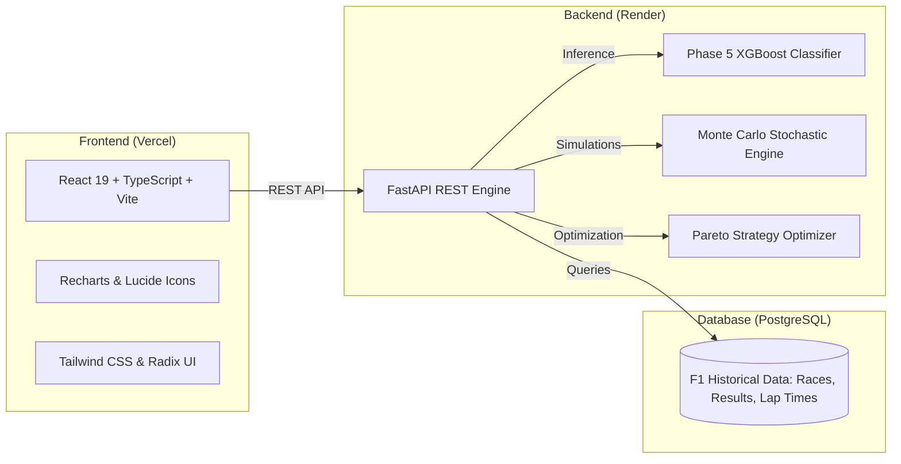

# 🏎️ F1 StrategyIQ: Data-Driven Race Strategy Optimization & Dynamic Pit-Wall System

[](https://fastapi.tiangolo.com)
[](https://react.dev)
[](https://www.typescriptlang.org)
[](https://www.python.org)
[](https://www.postgresql.org)
[](LICENSE)

An enterprise-grade Formula 1 strategic intelligence platform combining **Data Structures & Algorithms (DSA)**, **Machine Learning (Phases 3–5)**, and **Monte Carlo Simulations** to deliver real-time race simulations, stint optimization, and dynamic pit-wall decision support.

---

## 🌟 Key Features

1. **🏁 Overview & Telemetry Dashboard:** Real-time race position, lap delta tracking, fuel-adjusted base pace, and live ML Phase 5 pit-stop recommendations.
2. **📊 Head-to-Head Race Analysis:** Comparative telemetry analytics between teammate and rival drivers, actual vs. predicted lap time curves, and season progression.
3. **🛞 Tyre Intelligence:** Empirical compound degradation profiles (Soft, Medium, Hard), thermal cliff detection, and wear penalty curves.
4. **🧠 Strategy Optimizer:** Multi-objective strategy generator and Pareto frontier evaluation balancing:
   * Minimum Expected Race Time
   * Best Expected Finish Position
   * Risk Variance Minimization
   * Podium Likelihood Maximization
5. **⏱️ Dynamic Pit-Wall & Historical Replay:** Interactive lap-by-lap race replay with playback controls (Play, Pause, Forward, Backward), dynamic traffic re-entry loss curves, moving car reference lines, and live strategy call history.
6. **🔮 What-If Simulator:** Scenario perturbation engine comparing tactical options (*"Pit Now"* vs. *"Stay +3 Laps"* vs. *"Stay +5 Laps"*) under stochastic Monte Carlo simulations.

---

## 🏗️ Architecture & Tech Stack



* **Frontend:** React 19, TypeScript, Vite, Tailwind CSS, Recharts, Radix UI.
* **Backend:** FastAPI, Python 3.11+, Uvicorn, SQLAlchemy, Pydantic.
* **Machine Learning & Analytics:** XGBoost, Scikit-Learn, LightGBM, Pandas, NumPy, SciPy.
* **Database:** PostgreSQL storing historical Formula 1 telemetry, race results, and circuit profiles.

---

## 🚀 Local Development Setup

### 1. Prerequisites
* **Python 3.11+** installed
* **Node.js 18+** and **npm** installed
* **PostgreSQL** instance running

### 2. Backend Setup
```bash
# Clone repository
git clone https://github.com/sanskar620/DSA_F1.git
cd DSA_F1

# Create and activate virtual environment
python -m venv venv
# On Windows:
venv\Scripts\activate
# On Linux/macOS:
source venv/bin/activate

# Install dependencies
pip install -r requirements.txt

# Configure environment variables
cp .env.example .env
# Edit .env with your PostgreSQL credentials:
# DATABASE_HOST=localhost
# DATABASE_PORT=5432
# DATABASE_NAME=f1_strategyiq
# DATABASE_USER=postgres
# DATABASE_PASSWORD=your_password

# Start FastAPI backend
uvicorn backend.main:app --host 127.0.0.1 --port 8000 --reload
```
API Documentation will be live at `http://127.0.0.1:8000/docs`.

### 3. Frontend Setup
```bash
# Navigate to Frontend directory
cd Frontend

# Install node dependencies
npm install

# Start development server
npm run dev
```
Open `http://localhost:8080` in your browser.

---

## 🌐 Cloud Deployment Guide

### Why Deploy Frontend on Vercel and Backend on Render?
* **Vercel** is optimized for static and client-side web applications (React, Vite, Next.js). It does **not** support persistent Python web servers, long-running processes, or heavy machine learning runtimes (XGBoost/SciPy).
* **Render** is purpose-built to run persistent Docker containers, Python/FastAPI web services, background workers, and managed PostgreSQL databases.

```
+--------------------------+       REST API       +----------------------------+
|     Vercel (Frontend)    |  ----------------->  |      Render (Backend)      |
|  https://yourapp.vercel.app |  (VITE_API_URL)    | https://api.onrender.com   |
+--------------------------+                      +-------------+--------------+
                                                                |
                                                                v  SQL
                                                  +----------------------------+
                                                  |   Render / Supabase (DB)   |
                                                  |        PostgreSQL          |
                                                  +----------------------------+
```

### Deploying Backend to Render
1. Create a new **Web Service** on [Render](https://render.com).
2. Connect your GitHub repository (`sanskar620/DSA_F1`).
3. Set the following build settings:
   * **Environment:** `Python 3`
   * **Build Command:** `pip install -r requirements.txt`
   * **Start Command:** `uvicorn backend.main:app --host 0.0.0.0 --port $PORT`
4. In **Environment Variables**, add:
   * `DATABASE_HOST`, `DATABASE_PORT`, `DATABASE_NAME`, `DATABASE_USER`, `DATABASE_PASSWORD`  
     *(or `DATABASE_URL_ENV` with your full PostgreSQL connection string from Render PostgreSQL or Supabase)*
   * `MODEL_DIR=models/v1`

### Deploying Frontend to Vercel
1. Import your GitHub repository (`sanskar620/DSA_F1`) in [Vercel](https://vercel.com).
2. Set the **Root Directory** to `Frontend`.
3. Framework Preset: **Vite**.
4. In **Environment Variables**, add:
   * `VITE_API_URL=https://your-backend-app.onrender.com`
5. Click **Deploy**.

---

## 📊 Core Data Structures & Algorithms

* **Candidate Strategy Generation:** Pruned tree search enforcing strict FIA 2-compound regulations.
* **Monte Carlo Stochastic Simulation:** Models lap-time stochasticity $\sim \mathcal{N}(\mu_{\text{pace}}, \sigma_{\text{traffic}}^2)$, safety car events, and tyre degradation cliffs across $N=1,000$ iterations.
* **Pareto Multi-Objective Optimization:** Evaluates non-dominated frontier strategies across expected race time vs. finish position variance.
* **Phase 5 ML Pit Decision Engine:** Supervised XGBoost classifier predicting optimal stint termination windows based on telemetry features.

---

## 📜 License
This project is open-source under the MIT License.
